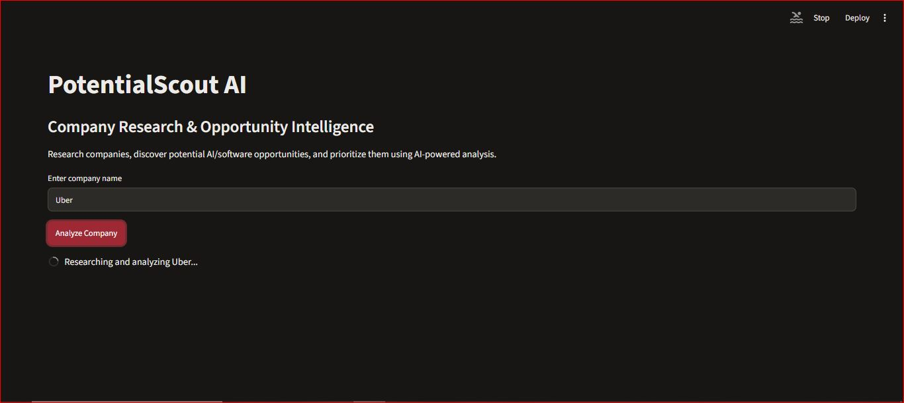
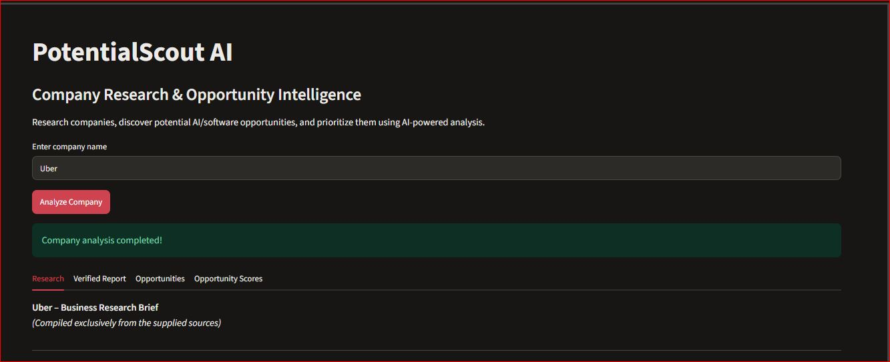
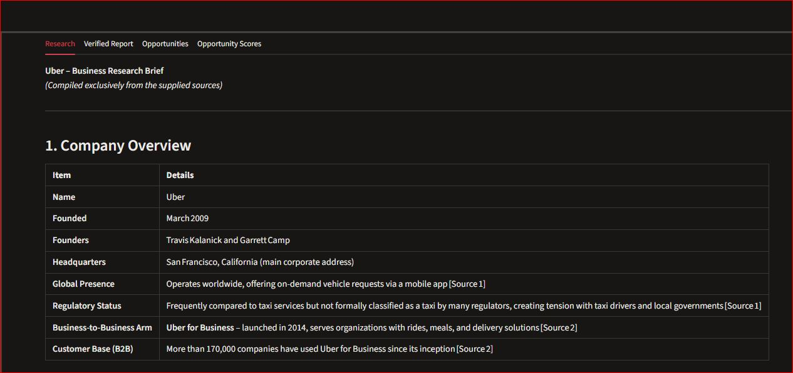
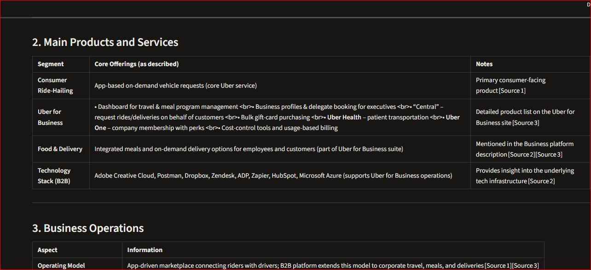
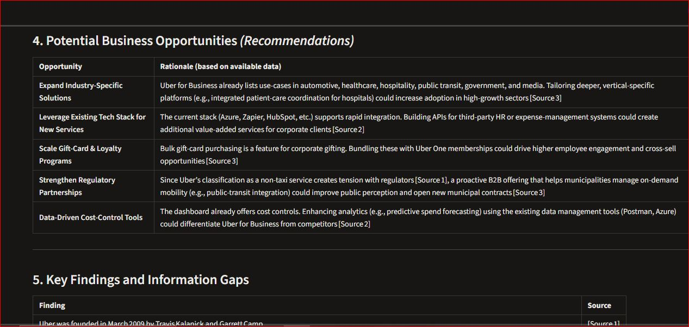
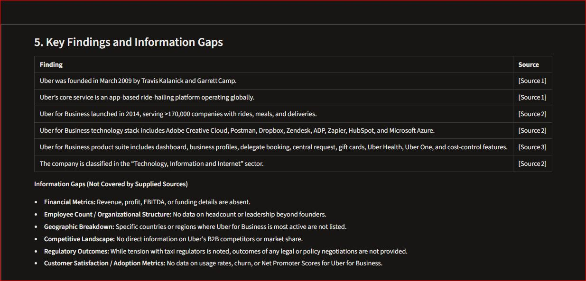
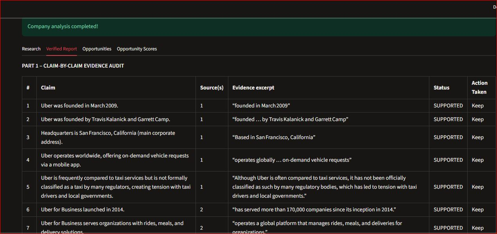
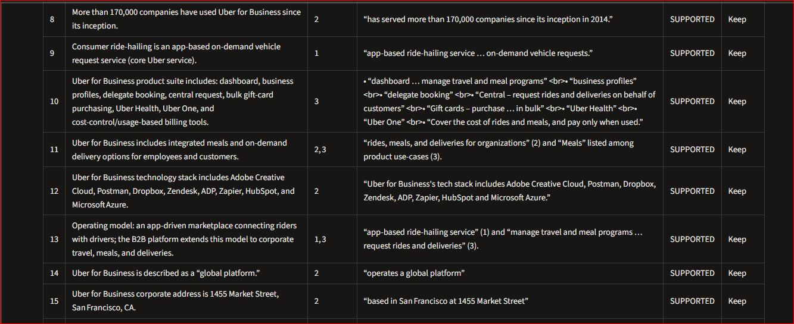
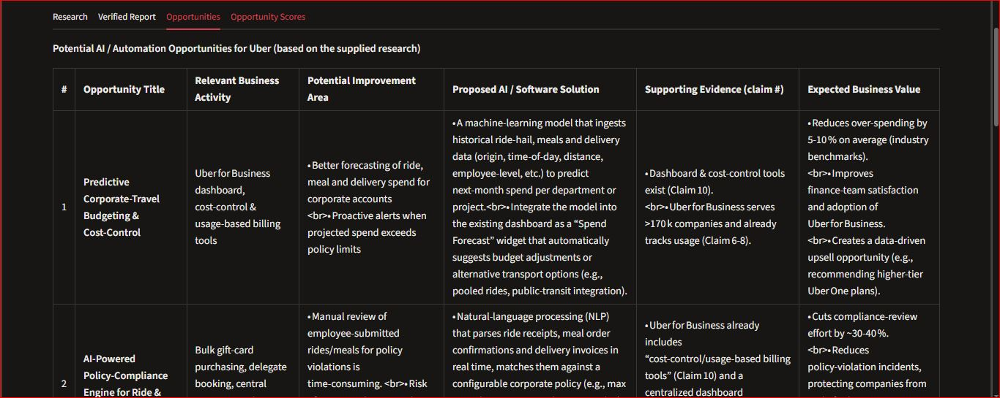

# PotentialScout AI

**AI-Powered Company Research & Opportunity Intelligence**

PotentialScout AI is a Python-based application that researches companies, identifies potential AI and software opportunities, and prioritizes them through LLM-powered analysis.

It combines web search, language models, and a stateful workflow to transform publicly available company information into structured business intelligence.

## Application Screenshots

### Main Interface

<p align="center">
  
</p>

### Company Research

<p align="center">
  
</p>

### Research Report

<p align="center">
  
</p>

### Verified Research

<p align="center">
  
</p>

### Opportunity Discovery

<p align="center">
  
</p>

### Opportunity Scoring

<p align="center">
  
</p>

### Additional Analysis Examples

<p align="center">
  
  
</p>

<p align="center">
  
  
</p>

## Overview

Finding relevant business opportunities requires researching company operations, understanding their products and services, and identifying areas where technology can provide value.

PotentialScout AI automates an initial stage of this process.

Users provide a company name, and the application performs a multi-stage research and analysis workflow to produce structured findings and prioritized opportunities.

## Key Features

- **Company Research:** Retrieves publicly available company information using Tavily Search.
- **LLM-Based Analysis:** Generates structured research reports using Groq-hosted language models.
- **Report Verification:** Reviews generated research against retrieved source material.
- **Opportunity Discovery:** Identifies potential AI and software opportunities based on company research.
- **Opportunity Scoring:** Evaluates and ranks opportunities using weighted business criteria.
- **Interactive Interface:** Presents research and analysis results through a Streamlit application.

## Workflow Architecture

The application uses LangGraph to coordinate a sequential, stateful workflow.

```text
                Company Name
                     |
                     v
              Research Node
                     |
                     v
              Analysis Node
                     |
                     v
            Verification Node
                     |
                     v
             Opportunity Node
                     |
                     v
               Scoring Node
                     |
                     v
              Final Results
```

### Workflow Components

| Node | Responsibility |
|---|---|
| Research | Retrieves company information using Tavily |
| Analysis | Generates a structured company research report |
| Verification | Reviews report claims against retrieved sources |
| Opportunity | Identifies potential AI and software opportunities |
| Scoring | Evaluates and ranks identified opportunities |

Each node contributes to a shared workflow state, allowing subsequent nodes to use the results of earlier stages.

## Opportunity Scoring Methodology

Each identified opportunity is evaluated using four weighted criteria.

| Criterion | Weight |
|---|---:|
| Strategic Fit | 30% |
| Evidence Strength | 30% |
| Potential Business Value | 25% |
| Implementation Feasibility | 15% |
| **Total** | **100%** |

Each criterion receives a score from 1 to 5.

The weighted score is normalized to a scale of 100:

```text
Score = (
    Strategic Fit × 30 +
    Evidence Strength × 30 +
    Business Value × 25 +
    Implementation Feasibility × 15
) / 5
```

Opportunities are then categorized into priority levels to help users focus on the most promising findings.

## Technology Stack

| Technology | Purpose |
|---|---|
| Python | Core application language |
| LangChain | LLM and tool integration |
| LangGraph | Stateful workflow orchestration |
| Groq API | Language model inference |
| GPT OSS 120B | Language model used for analysis |
| Tavily | Web search and information retrieval |
| Streamlit | Interactive application interface |
| Python Dotenv | Environment configuration |

## Project Structure

```text
PotentialScoutAI/
│
├── config/
│   ├── __init__.py
│   ├── models.py
│   └── settings.py
│
├── tools/
│   ├── __init__.py
│   └── search.py
│
├── workflow/
│   ├── graph.py
│   └── state.py
│
├── tests/
│   ├── __init__.py
│   ├── test_graph.py
│   ├── test_groq.py
│   ├── test_models.py
│   ├── test_search.py
│   └── test_search_tool.py
│
├── screenshots/
│   ├── 1.png
│   ├── 2.png
│   └── ...
│
├── app.py
├── requirements.txt
├── .env.example
├── .gitignore
└── README.md
```

## Getting Started

### Prerequisites

- Python 3.10 or later
- Groq API key
- Tavily API key

### 1. Clone the repository

```bash
git clone <repository-url>
cd PotentialScoutAI
```

### 2. Create a virtual environment

```bash
python -m venv .venv
```

Activate it on Windows:

```bash
.venv\Scripts\activate
```

### 3. Install dependencies

```bash
pip install -r requirements.txt
```

### 4. Configure environment variables

Create a `.env` file in the project root using `.env.example` as a template.

```env
GROQ_API_KEY=your_groq_api_key
TAVILY_API_KEY=your_tavily_api_key
```

Never commit your actual API keys or `.env` file.

### 5. Run the application

```bash
streamlit run app.py
```

The application will open in your default browser.

## Running Individual Test Scripts

Test scripts are available in the `tests/` directory.

Run the complete workflow test from the project root:

```bash
python -m tests.test_graph
```

Individual integration scripts can also be executed to test model configuration and web search functionality.

## Limitations

- Research quality depends on the availability and relevance of retrieved web sources.
- LLM-generated findings and opportunity scores require human review.
- LLM-based verification does not guarantee factual accuracy.
- Opportunity scores are analytical estimates, not validated business forecasts.
- The current workflow is sequential rather than a fully autonomous agent.

## Future Improvements

- Persistent company research history.
- Database integration.
- Personalized business outreach generation.
- Improved source attribution and evidence traceability.
- Structured opportunity extraction.
- Deployment and production monitoring.
